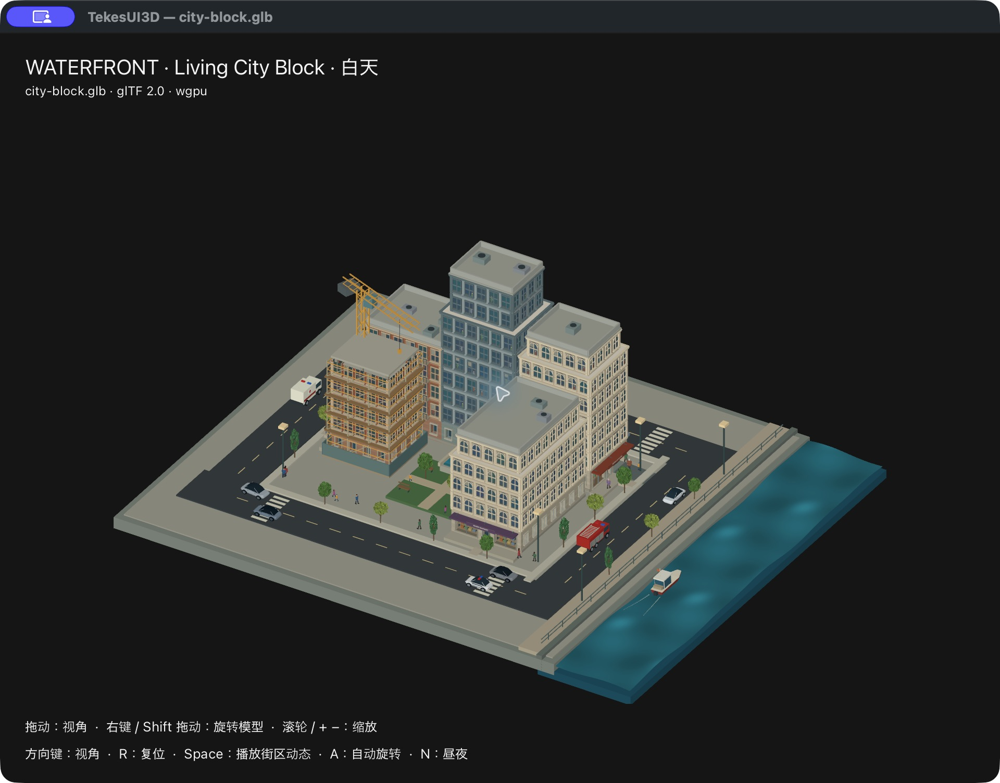
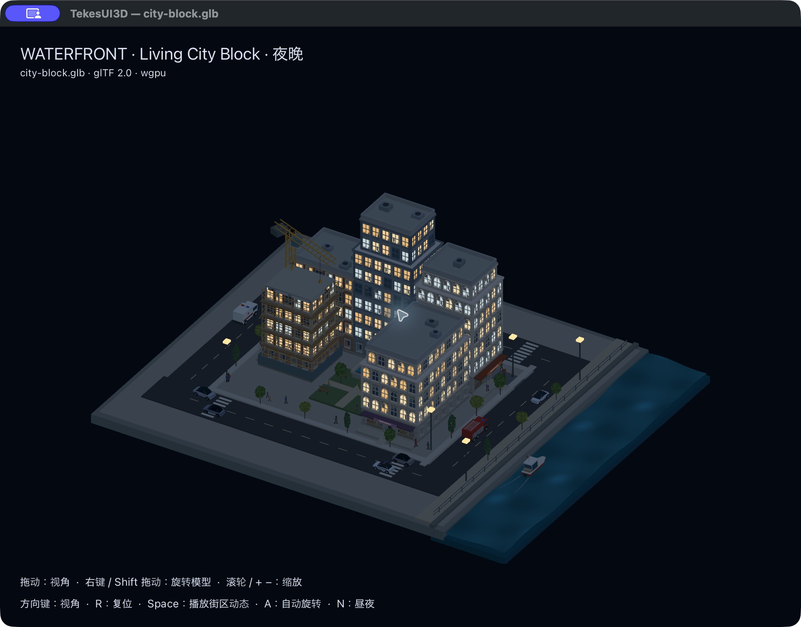

# 街区窗景与昼夜（2026-10-21）

当前 worktree 增加了独立昼夜模式。通过 **Lighting → Day / Night** 或 **N** 切换；支持暂停时切换，Space 恢复动画。CLI `--night` 可生成对应快照。夜间 HUD 使用浅色文字，昼夜不依赖系统 UI 主题。

四栋楼各自使用原创、固定种子的窗景图案，部分窗内有站立、坐着或看书的人物剪影，含家具、百叶窗与窗框遮挡。每栋楼有自己的亮灯/有人分布；图案在各自 UV 网格中重复，不是逐窗唯一的三维室内。人物是室内贴图细节，不是会走动的室内角色。

夜间环境光和方向光变成冷色，部分窗户、街灯与招牌自发光。当前不做局部投光、动态阴影、光照反弹或 bloom。效果由独立的通用 `Lighting3D` 和 glTF 核心 `emissiveFactor` / `emissiveTexture` 提供，Renderer3D 没有街区或昼夜规则。CPU 不逐帧生成窗内人物或窗灯，也不逐帧遍历窗户。光照未变化时没有额外 uniform 上传；切换更新 48 字节，网格、实例、材质与 opaque bundle 不重建。基色和自发光按资产 image 索引共享 GPU 贴图，mipmaps 仍由 GPU 生成。

自主动画 60Hz、输入/旋转保留显示刷新节奏的策略不变。上次性能报告对应改动前资产；本次验证资源复用，没有重新测量 CPU/GPU 占用。

## 原生窗口对照

同一暂停时刻，分别用 N 切换并捕获：

## 验证

11 个 viewer 测试、9 个 scene3d CPU 测试和 8 个真实 GPU 测试通过，Clippy all-targets / warnings denied 通过。新增 GPU 回归检查亮窗确实比白天更亮、全场景夜间更暗、昼夜往返恢复白天像素、切换只更新 48 字节、重复帧零额外光照更新、网格/实例/绘制缓存保持不变，并拒绝无效光照方向。保留既有 GPU 蒙皮、morph、法线、透明合成和街区生命周期验证。

原生窗口已核验菜单、快捷键、暂停时切换及恢复动画；仍使用当前 worktree，其他未提交改动保留，未提交。资产哈希和图案审计见 [JSON 记录](city-block-day-night-20261021.json)。
