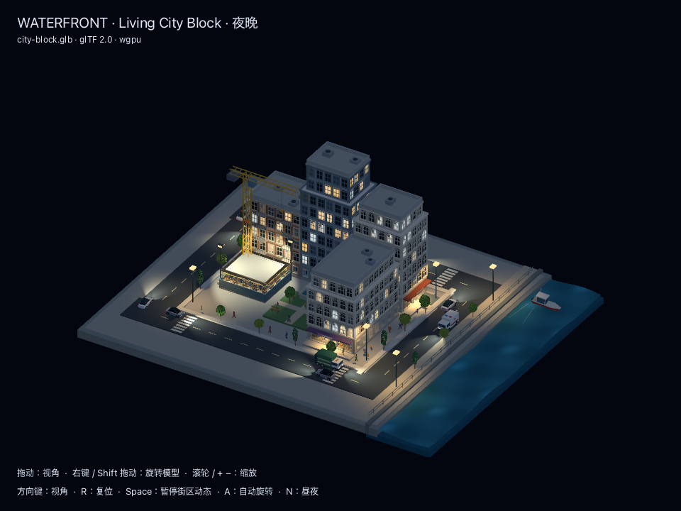
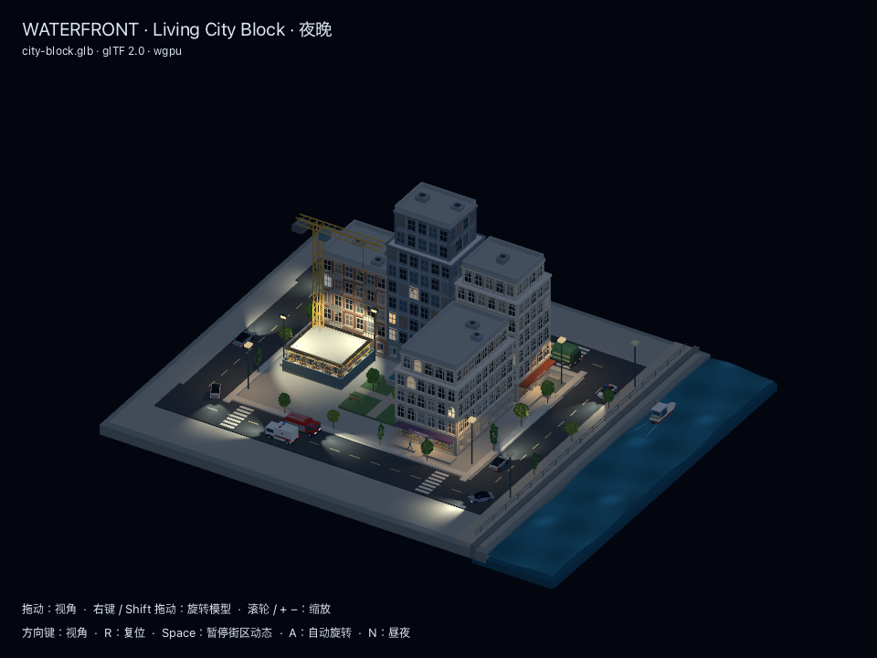
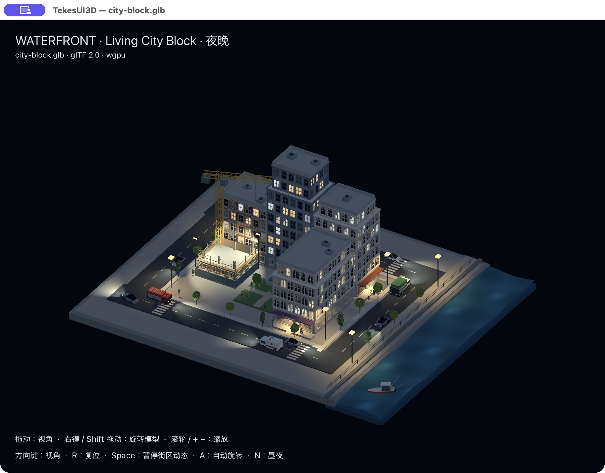

# City Block 实例时间状态与夜间生活

继续使用 gallery-design-baseline/TekesUI 当前 worktree，未提交，保留其他 WIP。全部素材为原创生成，没有游戏素材。

## 模块边界

- tekes-ui-city：路径、灯具、施工和人物的独立数据配方。
- district adapter：昼夜切换、施工暂停累计和实例参数映射。
- Scene3D：四个可冻结时钟、通用可见性时间线、局部灯与调光曲线。
- wgpu：路线/变形、遮挡代理、灯光、人物离场和窗帘/室内剪影。

## 当前实例状态

| 物件 | 晚间 | 午夜后 |
|---|---|---|
| 施工楼/脚手架/吊车 | 冻结施工时钟，工地聚光灯照明 | 继续冻结；白天从原进度续建 |
| 住户窗格 | 每楼入住率 50%，仅固定已入住房间可有人/亮灯 | 多数熄灯，保留夜猫子 |
| 窗帘 | 部分房间分批缓慢拉拢，遮住人物，布帘透光 | 沿同一房间状态保留 |
| 街上行人 | 32 位按不同时间离场 | 保留 5 位；暂为 GPU 可见性时间线 |
| 路灯 | 六灯开启、照亮地面 | 主路四灯降至 55%，滨水两灯关闭 |
| 一楼门口/雨棚 | 每入口双墙灯、两盏下照灯 | 墙灯降至 35%，雨棚灯按打烊时间关闭 |
| 车辆 | 前灯/红尾灯，光锥沿 GPU 路线转向 | 持续运行 |

夜间 20:00 开始，60 秒对应一小时；暂停冻结所有状态。N 切昼夜，R 复位。空置窗格昼夜都暗淡且无人，施工窗格从不使用住宅自发光。

## 验证与限制

33 项测试通过：viewer 14、city 1、scene3d CPU 10、实际 wgpu GPU 8；Clippy all-targets -D warnings 通过，第二公开 API 消费者 snapshot 通过，签名校验通过，GLB/JSON 重导出哈希一致，几何/比例/入口审计通过。33 项是定向检查，不是工作区全量测试。

晚间/午夜隔离窗景的暖亮像素为 2119/505，局部光代理阴影改变 3227 像素；已检查 GPU 离场结果与直接省略对应实例的像素一致，独立施工时钟在夜间冻结、白天续时。既有 120 帧回归仍无逐帧顶点、pose 或实例上传。每帧仅更新最多 32 字节环境与时钟；相机变化另有 128 字节。实例增加 timeline vec4，现为 144 字节；没有新增窗帘动画贴图。

灯光最多 64，遮挡代理最多 96；本场景为 44 灯、64 代理。阴影为椭球近似，窗内人物/窗帘为 GPU 窗景效果，房间不能进入。人物尚不导航回家。没有用旧 CPU/GPU 百分比声称本次性能验收；最新百分比另行实测。

## 原生窗口

最终签名应用已重新启动，Lighting 菜单切入夜景，实际窗口可见门口/雨棚照明、路面光束、固定空置暗窗和窗帘。后台窗口恢复前可能暂未出现首帧，恢复后实际绘制已核对；未将空白或暂停窗口的 CPU 采样用于性能结论。

