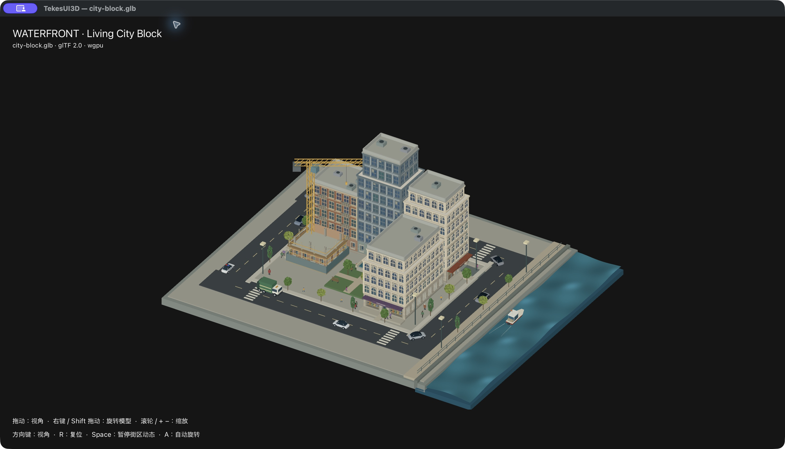

# 连续临街布局与动画成本（2026-10-21）

继续使用 gallery-design-baseline/TekesUI，保留其余 WIP，未提交。

北侧住宅与办公楼共墙；办公楼与酒店之间留 1.0m 巷道，酒店与南侧商住楼之间留 1.4m 巷道。施工地块随布局整体移动，内院保留。共墙侧不再添加低层窗框浮雕；门仍分别朝西、北、东、南，两个车库仍朝各自街道，门、车库到街道的通路经过建筑包围盒检查。四名新增行人沿两条窄巷构成的闭合路线行走，窄巷关闭横向漂移；路径与转角逐段检查人物中心线的通行余量。人物仍使用既有 GPU 实例、步态与独立速度。



## 实测

M4 / 32GiB，Release，wgpu / Metal。两版使用同一最终 GLB/JSON、同一大窗口，3D 目标 2960×1362px，2× backing，4× MSAA；CPU 每种状态单独采样 60s，100% 表示一个逻辑核心。Animation 菜单跟踪以保持前台。CPU 基准期间没有启用 GPU 跟踪。

| 状态 | CPU 平均 | 本进程 GPU 活跃时间比例 | Metal 分配 | 进程 footprint |
|---|---:|---:|---:|---:|
| 优化前自主动画 | 23.73% | 15.09% | 250.88MiB | 505.58–507.81MiB |
| 优化后自主动画 | 12.48% | 9.79% | 251.27MiB | 440.52–440.89MiB |
| 优化后持续旋转 | 22.96% | 16.60% | 251.27MiB | 442.42–447.13MiB |

自主动画 CPU 本轮下降 47.4%。主要来自把无交互街区动画控制在 60 次绘制/秒；场景时钟仍接收全部显示回调的真实 dt，车、人、水、树和施工不会变慢。输入、拖动与自动旋转仍跟随显示刷新。GPU 跟踪中自主动画约 60.18 次 3D pass/s，旋转约 117.33 次/s。该频率是绘制 pass 频率，未把它冒充屏幕实际呈现 FPS。

通用 Renderer3D 同时省去缓存 opaque bundle 中重复的 pipeline/material/camera 绑定，不改变绘制顺序。仅此项的 CPU 为 23.20%，与原版区间重叠，不声称显著的每帧 CPU 收益。GPU 蒙皮、morph、索引网格、正确法线与直接合成保留，未减少模型细节或 MSAA。

GPU 由独立 Metal System Trace 取得：前版请求 8s，后版和旋转各 3s，实际活动窗口含工具首尾。活跃比例把目标 PID 的重叠 Vertex/Fragment/Compute 区间合并，避免重复相加，**不是整机 GPU 利用率**。3D pass 的平均 GPU 时间区间分别为 1.11、1.38、1.18ms；它包含阶段间空隙，短采样会波动，不声称每帧 GPU 变快。Metal 分配取自 `MTLDevice.currentAllocatedSize`，与进程统一内存重叠；不要把两者相加。进程 footprint 包含缓存和驱动记账，下降不等同于模型显存减少。

初次基线窗口未实际绘制，1.17% CPU 数据已排除。可见性恢复后才开始报告中的基准。原始 CPU 逐秒记录、GPU 摘要、模型哈希与范围说明保存在 [JSON 记录](city-block-tight-layout-performance-20261021.json)。这是本轮单次原生对照与短 GPU 跟踪，不是全工作区或全部机器的性能承诺。

## 验证和复测

- 原生窗口确认最终布局，GLB 几何/门洞/车库/巷道通行审计通过。
- 10 个 viewer 测试、9 个 scene3d CPU 测试、8 个真实 GPU 测试通过；Clippy all-targets，warnings denied 通过。
- 30/60/90/120/144Hz 节奏、显示抖动、错过期限与交互重置有回归测试。固定 24s 的优化前后 PNG 字节一致。
- 新增 `scripts/summarize-metal-trace.py` 汇总指定 PID 的 Metal XML，检查过重叠区间、PID 隔离、共享 encoder 与内存单位。它是离线分析脚本，正常渲染不回读图像或 GPU 时间戳。

```sh
xcrun xctrace record --template 'Metal System Trace' --attach PID --time-limit 3s --output /tmp/city.trace
xcrun xctrace export --input /tmp/city.trace --xpath '/trace-toc/run[@number="1"]/data/table[@schema="metal-gpu-intervals"]' --output /tmp/city-gpu.xml
xcrun xctrace export --input /tmp/city.trace --xpath '/trace-toc/run[@number="1"]/data/table[@schema="metal-current-allocated-size"]' --output /tmp/city-allocated.xml
python3 crates/tekes-ui-3d/scripts/summarize-metal-trace.py --gpu /tmp/city-gpu.xml --allocated /tmp/city-allocated.xml --pid PID --output /tmp/city-summary.json
```
