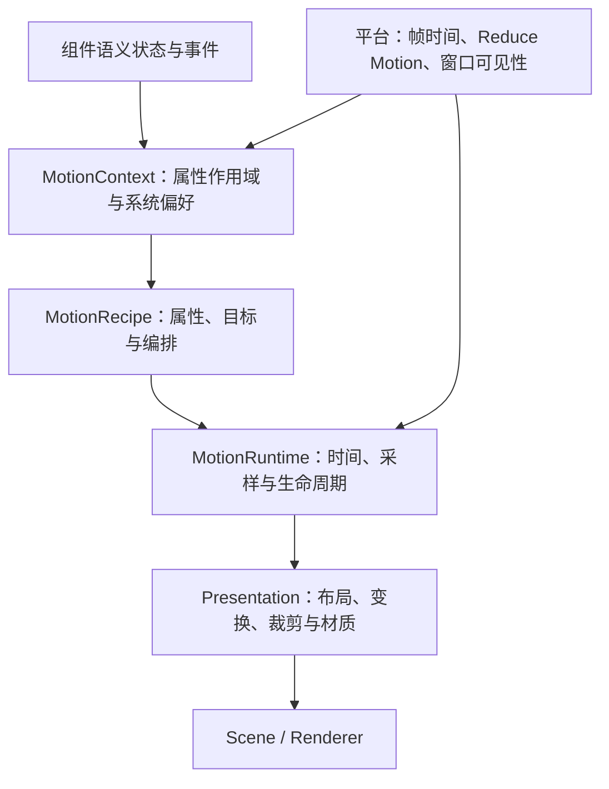

# Component 动画基础：Apple 官方研究与 TekesUI 模型草案

> 集成状态：本文第 5、6 节保留研究阶段的配方与 motion.toml 提案。当前项目已采用 JSON Design System，Gallery 以 `design/source/motion.json` 为唯一 motion 参数来源，已合并 JSON 优先于这些旧提案。实际接线和验收边界见 [motion-preview 交接](../handoffs/motion-preview.md)。

研究日期：2026-10-15。状态：设计草案；独立数值内核与属性通道已实现，参数实测和原生对照尚未完成。实际 API、边界和验证命令见 [tekes-ui-motion](../../crates/tekes-ui-motion/README.md)。

本文为纯 Rust component 准备动画机制、组件动效配方和 Gallery 验收入口。Apple 事实只引用官方 HIG、API 文档和 WWDC；下文标注「TekesUI 提案」的结构、数值和规则，是本项目设计，不是 Apple 系统控件的内部实现或精确参数。

## 1. 官方资料给出的方向

Apple 的 motion 指南把动画用于反馈、状态与关系表达。[HIG Motion](https://developer.apple.com/design/human-interface-guidelines/motion)

从实现上，需要同时理解几层：

| 层 | 官方公开机制 | 对 component 的启发 |
|---|---|---|
| 状态更新 | SwiftUI 用 `Animatable`、`Animation`、`Transaction` 协作，把一次更新的动画上下文传给可动画属性 | 业务状态立即更新，呈现值按帧计算；动画作用域必须明确 |
| 运动 | 弹簧能承接初速度，中途换目标时延续速度；没有回弹的弹簧同样常用 | 可交互几何变化优先采用可重定向弹簧 |
| 编排 | PhaseAnimator 表达阶段；KeyframeAnimator 表达多轨时间编排 | 反馈短片与长期状态变化使用不同模型 |
| 材质 | Liquid Glass 将外观、交互反馈与形变结合 | 材质参数与几何运动共同编排，但材质有独立渲染成本 |

以上分别见 [Explore SwiftUI animation](https://developer.apple.com/videos/play/wwdc2023/10156/)、[Animate with springs](https://developer.apple.com/videos/play/wwdc2023/10158/)、[Wind your way through advanced animations](https://developer.apple.com/videos/play/wwdc2023/10157/)、[Meet Liquid Glass](https://developer.apple.com/videos/play/wwdc2025/219/)。

本次也核查了 [WWDC26：Create UI prototypes using agents in Xcode，11:19 起](https://developer.apple.com/videos/play/wwdc2026/227/?time=679)。该节继续区分 ease、spring 与摩擦/惯性，并建议用调参面板、分阶段预览和并排展示缩短反馈循环。它是调优方法资料，不提供系统控件完整参数表。不能因为主要机制在 WWDC23 已说明，就把旧视频年份当作机制已失效；也不能把 WWDC25 的 Liquid Glass 当作动画系统的全部。

## 2. Apple 机制与实现边界

### 2.1 目标值与呈现值

SwiftUI 的属性可同时具有目标状态与随时间变化的呈现状态；一次更新的 transaction 携带动画上下文，属性据此驱动插值。局部作用域可避免动画意外影响任意子内容。[SwiftUI 动画机制](https://developer.apple.com/videos/play/wwdc2023/10156/)

Core Animation 则明确区分 model layer 与 presentation layer；`presentation()` 可读取接近屏幕当前显示的值。[Core Animation Basics](https://developer.apple.com/library/archive/documentation/Cocoa/Conceptual/CoreAnimation_guide/CoreAnimationBasics/CoreAnimationBasics.html)、[CALayer.presentation()](https://developer.apple.com/documentation/quartzcore/calayer/presentation())

这两套 API 不能简单视为同一实现。对 Rust 可借鉴的共同点，是将语义状态与视觉过渡分开；本文不推断 SwiftUI 的每条动画都由 CALayer 执行，也不假设动画天然全部在 GPU 上运行。

### 2.2 连续性与弹簧

Apple 公开强调位置和速度连续。弹簧可接收手势释放速度，也可在目标改变时承接当前速度。`duration` 是感知时长，区别于实际收敛时间。[Animate with springs](https://developer.apple.com/videos/play/wwdc2023/10158/)

公开预设的语义是：`smooth` 无回弹、`snappy` 少量回弹、`bouncy` 更多回弹；预设名称不足以证明某个原生控件用了哪组参数。[Animation.snappy 与相关预设](https://developer.apple.com/documentation/swiftui/animation/snappy)

`bounce = 0` 对应临界阻尼，正值对应欠阻尼，负值对应过阻尼；`bounce = 1` 对应无阻尼。[Spring.bounce](https://developer.apple.com/documentation/swiftui/spring/bounce)

### 2.3 Transition、阶段与关键帧

属性动画处理同一身份对象的数值变化；transition 处理层级中的插入和移除，并可为进入、退出指定不同效果。[SwiftUI Animations](https://developer.apple.com/documentation/swiftui/animations)

阶段适合按状态推进；关键帧适合指定时间轨道。Apple 提醒关键帧不能像弹簧那样自然重定向，因此不适合频繁改变目标的交互。[Advanced animations](https://developer.apple.com/videos/play/wwdc2023/10157/)

### 2.4 完成有不同含义

`logicallyComplete` 时动画可能还在长尾；`removed` 表示整个动画结束并移除。新动画与原完成回调之间也有明确语义。[AnimationCompletionCriteria.logicallyComplete](https://developer.apple.com/documentation/swiftui/animationcompletioncriteria/logicallycomplete)

TekesUI 应显式规定自己的回调协议，不能用一个固定延时推断完成，也不能让视觉完成回调决定业务操作是否成功。

### 2.5 Liquid Glass 的含义

Apple 将它用于浮于内容之上的功能层；外观包含 lensing、光照和自适应。materialize 也涉及材质变化。[Meet Liquid Glass](https://developer.apple.com/videos/play/wwdc2025/219/)

SwiftUI 公开了容器、身份与 transition：`GlassEffectContainer`、`glassEffectID`、`matchedGeometry` / `materialize`，容器间距参与决定形状何时融合。[Applying Liquid Glass to custom views](https://developer.apple.com/documentation/swiftui/applying-liquid-glass-to-custom-views)

macOS 对应公开接口包括 `NSGlassEffectView` 和 `NSGlassEffectContainerView`。[Build an AppKit app with the new design，17:30 起](https://developer.apple.com/videos/play/wwdc2025/310/?time=1050)

对 TekesUI 的结论：先完成普通组件的运动机制。原生玻璃参考放在伴随对照环境；纯 Rust 单 surface 的玻璃渲染另设实验，不以模糊背景加透明度声称已复现 Liquid Glass。官方公开了行为和 API，完整 shader 与系统控件调参仍不能由这些资料得出。

## 3. TekesUI 提案：四层模型



所有以下约定都是 TekesUI 提案。

### 3.1 基础类型与所有权

以下是接口词汇草图，不是已存在或已编译的 Rust API：

```rust
enum MotionSpec {
    Instant,
    Tween { seconds: f64, curve: TimingCurve },
    Spring { frequency_hz: f64, damping_ratio: f64 },
    Keyframes { tracks: Vec<Track> },
}

struct Animated<T> {
    target: T,
    presented: T,
    velocity: T::Tangent,
    generation: u64,
    // 运行时另存起始采样、单调起始时间与 spec。
}

struct MotionContext {
    cause: UpdateCause,       // pointer / keyboard / programmatic / restore
    scope: PropertyScope,
    reduce_motion: bool,
    enabled: bool,
}
```

- 组件拥有语义状态和动效配方；运行时拥有 channel 与时钟；scene 消费同一帧的呈现快照。
- 一个 `(ComponentId, PropertyId)` 只有一个基础动画写入者；新目标替换旧目标。关键帧反馈用显式的附加变换层，避免与布局、拖动同时争写 offset。
- `ComponentId` 必须含实例世代，虚拟列表复用 slot 不复用动画身份。卸载时取消 channels、定时器与未完成回调。
- `T::Tangent` 表示同维度变化量：位置速度为 pt/s，角速度为 rad/s，透明度速度为 1/s。不要把物理速度与归一化 initialVelocity 混用。
- 已按后续决定建立独立 `tekes-ui-motion` crate，先与 F0/F1 并行；库不依赖组件身份、平台和渲染。组件层负责持有属性通道与实例世代，使用同一时间戳采样。

### 3.2 可动画的值

| 值 | 插值/采样规则 | 限制 |
|---|---|---|
| scalar、point、size、insets | 数值或逐分量采样 | size 不得产生负可用尺寸 |
| angle | 明确最短路径或指定旋转圈数 | spinner 使用累计角度，避免每圈回跳 |
| transform | 2D 平移、旋转、缩放分量 | 不直接逐元素插值任意矩阵；缩放不倒置 |
| opacity、颜色 | 有界曲线；颜色初期使用线性 sRGB 预乘 alpha，先解析到同一空间 | 不给 opacity 使用可越界弹簧；主题切换不自动变色 |
| rounded rect | rect 与受约束 radius | radius 每帧受当前尺寸约束 |
| path | 仅同拓扑的已注册路径 | 任意两图标默认交叉淡化，不承诺任意 morph |
| 文本、离散枚举 | 内容切换或双层交叉淡化 | 不插值字符串，不在动画中反复改变字形宽度 |

### 3.3 曲线与弹簧的数学契约

Tween 用绝对时间进度 `u = clamp((now-start)/duration, 0, 1)`，零时长直接落终点。三次 Bézier 以时间为横轴，必须解出曲线的 x 参数后再求 y，不能把进度直接作为 Bézier 参数。Tween 重定向可保证位置连续；这里不承诺速度连续，几何交互改用 Spring。

Spring 采用标准阻尼振子，先以物理参数实现，避免在未对照前声称复刻 Apple 感知时长转换：

```text
ω₀ = 2π × frequency_hz
m = 1, k = ω₀², c = 2ζω₀, ζ = damping_ratio
y = x - target
y'' + 2ζω₀ y' + ω₀² y = 0
```

从起始位移 `y₀`、初速度 `v₀` 解析采样：

```text
欠阻尼 0 < ζ < 1：
  ωd = ω₀√(1-ζ²)
  A = y₀, B = (v₀ + ζω₀y₀)/ωd
  y(t) = exp(-ζω₀t) × [A cos(ωdt) + B sin(ωdt)]

临界阻尼 ζ = 1：
  A = y₀, B = v₀ + ω₀y₀
  y(t) = (A + Bt) × exp(-ω₀t)

过阻尼 ζ > 1：
  r₁ = -ω₀(ζ-√(ζ²-1)), r₂ = -ω₀(ζ+√(ζ²-1))
  A = (v₀-r₂y₀)/(r₁-r₂), B = y₀-A
  y(t) = A exp(r₁t) + B exp(r₂t)

x(t) = target + y(t), v(t) = y'(t)
```

接近临界阻尼时需用数值稳定分支并核对极限连续性；大 ζ 时避免根的相消。拒绝 NaN、无穷值、非正频率及非正阻尼的有限动画。初期无需开放无阻尼无限弹簧；循环动效有单独生命周期。

新目标在 `t₀` 到来时，先采样旧动画的 `x(t₀), v(t₀)`，再以它们为新初值，目标换成 `target_new`。位置与速度连续，加速度可以改变。换目标不将速度清零，也不回到旧逻辑起点。

`ζ = 1` 的无回弹指静止起步的自然响应；带初速度时仍可能越过目标。开关滑块等有边界的几何属性需要独立边界策略，不能仅凭阻尼值保证不越界。

Apple 的 `duration/bounce` 可作为后续设计入口；真正开放前，以官方 `Spring.value` / `velocity` 建立参数与轨迹对照。初版 `frequency_hz/damping_ratio` 不等同于 Apple 的 `duration/bounce`，也不能把已有 0.18 秒机械换算为 `frequency=1/0.18`。

### 3.4 手势与边界

- 拖动阶段直接呈现手势位置，避免目标后面再串一个低通弹簧造成跟手滞后。
- 释放时取同一坐标系、同一单位的速度；吸附目标由组件状态机按位置和速度选定，运行时负责运动。
- 再次抓住运动对象时，从当前呈现位置建立拖动基准，不能跳回逻辑目标。
- 有界滑块可在边界碰撞时停到边界、清除向外速度；该碰撞不承诺速度连续。弹性越界需单独定义阻力和回归策略。
- mac 触控板惯性继续消费平台的 momentum phase，不再叠一层自行模拟的惯性；符合章程原则。自定义拖拽吸附和滚动惯性是不同事件路径。

### 3.5 作用域、生命周期与完成

每次更新的 context 只影响列出的属性；组件自身 hover/press 不传播给任意 child content。初次挂载、恢复窗口状态与后台数据装载默认即时完成；进入动画必须显式选择。

有限动画提供三类一次性通知：

| 通知 | TekesUI 契约 |
|---|---|
| `LogicalComplete(generation)` | recipe 指定的语义时间已到；可继续轻微运动 |
| `Settled(generation)` | 位置误差与速度均低于阈值，精确落终点并停止调度 |
| `Cancelled(generation, reason)` | 被替换、卸载或偏好切换；不再报告该 generation 的成功完成 |

这是本项目协议，不声称与 SwiftUI 的中断回调规则逐项相同。取消后，排队通知派发前还要核对 generation；防止快速开关时旧回调删除新节点。

建议起始收敛阈值：几何位置 0.1 个设备像素，几何速度 0.5 个设备像素/s；scalar 分别为 `1e-4`、`1e-3/s`。均为待测初值。多分量取最大归一化误差；位置和速度同时满足，并用衰减包络或未来一个名义周期的上界检查，避免振荡穿过终点时提前停止。另设有限动画最大运行保护，触发时落终点并记录诊断。

退出节点保留绘制所需快照直到 Settled；语义删除后立即停止命中与无障碍曝光。退场中重新进入需同身份接管当前呈现快照。业务状态从不等退场动画才提交。

## 4. 帧循环、布局与输入

以下为 TekesUI 架构提案，并非 Apple 内部渲染流水线描述。

1. 平台输入进入组件状态机，产生目标值更新及局部 MotionContext。
2. 在同一个单调时间戳采样所有活动 channel；用绝对时间解析计算，避免按帧累加误差。
3. 对影响布局的呈现约束执行必要布局；对 transform/opacity 仅更新 scene 属性。
4. 生成不可变的呈现快照，绘制、裁剪、命中测试使用一致的变换与 clip。
5. 仅存在可见活动动画、输入或其他脏内容时请求下一帧；收敛后停止调度。

具体约束：

- 60/120Hz 使用实际帧时间，不能写死每帧 1/60；窗口遮挡/不可见暂停绘制和循环反馈。重新可见时有限动画按经过时间采样，循环反馈重新定基准。
- 动画布局失效与绘制失效分开。只改变 opacity 或平移，不应重新 shaping、断行或上传整套 glyph atlas。
- disclosure 默认用一次终态测量、clip reveal 与兄弟节点位置过渡；内容宽度不变时不逐帧重排文字。真正改变可用宽度的组件需走布局动画并计入预算。
- 共享几何转换须把两端 rect 转到相同根坐标系，并处理滚动、父 transform、clip、锚点与层级；否则先用淡化回退。
- 交互中跟随可见几何命中；退出中的节点不可命中。AX 的语义状态即时更新，AX 几何、IME 候选窗及 caret rect 按呈现位置更新，不让候选窗跳到未来位置。
- 拖动分隔条、文本选择和输入法组字阶段不添加装饰性布局动画。焦点立即可用，焦点环淡入不应延迟键盘导航。

## 5. 常见组件动画配方

以下参数全部是 TekesUI 的 Gallery 调参起点，不是从 Apple 控件测出的数值。位移单位 pt、时间单位秒；同一配方可根据控件尺寸和输入方式调整。桌面按钮默认只做色彩反馈，缩放限图标或浮动控件。

基础曲线：

| 名称 | 定义 | 用途 |
|---|---|---|
| `feedback` | tween 0.12，Bézier (0.2, 0, 0, 1) | hover、颜色、焦点环 |
| `fade-in` / `fade-out` | tween 0.12 / 0.10，同上 | 内容显隐 |
| `geometry` | spring 4.5Hz，ζ=1，logical 0.18 | 小范围几何变化 |
| `selection` | spring 4.5Hz，ζ=0.9，logical 0.18 | 选中指示器 |
| `disclosure` | spring 3.5Hz，ζ=1，logical 0.30 | 列表、区域展开 |
| `surface` | spring 3Hz，ζ=1，logical 0.30 | 浮层、小面板 |
| `celebrate` | spring 3Hz，ζ=0.75，logical 0.50 | 明确触发的一次性反馈 |

`logical` 是 TekesUI 配方的语义完成时间；它不截断弹簧，也不等于 Apple perceptual duration。

| 配方 / 常见 component | 变化 | 中断与状态规则 | Reduce Motion |
|---|---|---|---|
| Hover / Button、Row | 背景、描边按 feedback 过渡 | enter/leave 从当前颜色接续；disabled 立即取消 | 保留轻微色彩反馈 |
| Press / IconButton | 按下立即高亮；可选 scale 1→0.97，释放用 geometry 回 1 | 拖出、取消、失焦均释放；不延迟 action | 只保留高亮 |
| Selection / Segmented、Tabs | 指示器 rect 用 selection；标签颜色用 feedback | 快速 A→B→C 直接改目标，不排队 | 指示器即时换位，颜色短淡化 |
| Toggle / Switch | 滑块位置 geometry，轨道颜色 feedback | 每次切换即时更新 checked；滑块用边界策略 | 即时位置与颜色 |
| Disclosure / Tree、Accordion | 箭头旋转、clip、兄弟位移用 disclosure | 正反切换承接当前值；稳定行 ID | 即时布局，内容可短淡化 |
| Insert/remove / List | insert 淡入并可偏移 4；remove 淡出，其他行几何接续 | 稳定 item ID；批量加载默认不逐行动画 | 淡入淡出，行位移即时 |
| Popover / Tooltip | 从源锚点 scale 0.98→1、淡入；退出更短淡出 | tooltip 的等待时间属于交互策略；Esc 立即失去交互 | 仅淡化 |
| Sheet / Panel | 源锚点或边缘呈现；surface + 遮罩淡化 | 焦点迁移即时；交互 dismiss 可接管运动 | 淡化，不大幅缩放或滑动 |
| Content switch / Label、Badge | 旧新内容交叉淡化；数字滚动可选 | 不对普通正文缩放；读屏只暴露当前内容 | 交叉淡化或即时 |
| Drag settle / Slider、Card | 手势直接跟随；释放后 geometry 吸附 | 初速度携带；重抓从呈现值接管 | 即时吸附 |
| Progress / ProgressBar | 确定进度用短 tween，spinner 匀速旋转 | 任务完成即时显示；回退值需有语义原因 | spinner 换静态忙碌标记/文字 |
| Error / Input | 可选 0.28s 水平关键帧 0,-3,3,-2,2,0；错误文本即时出现 | 连发合并，限制重复；不能只靠摇动表达错误 | 错误文字、图标和边框 |
| Success / Check、Badge | 图标可选一次 celebrate，或两阶段强调后恢复 | 事件 generation 触发一次，不随 rebuild 重播 | 静态完成状态 |
| Shared geometry / Card→Detail | 同身份 rect、radius、clip 协同，内容可淡化 | 来源缺失、不可见或坐标不可比较时回退 | 淡化 |
| Glass morph / Toolbar group | geometry + 材质轨道协调 | 后续实验；普通组件不依赖它 | 简化材质、移除形变 |

循环 spinner 在局部区域使用，不能让整个窗口每帧重新布局。骨架 shimmer、持续脉冲、大范围 parallax 不列为基础默认动画。

## 6. motion token 的演进

现有 [design/README.md](../../design/README.md) 约定五个时长：instant=0、stateChange=0.12、geometry=0.18、listExpansion=0.3、expansion=0.5。它们可继续保留作语义节奏，但单个时长无法定义运动机制。

提议将未来 `design/tokens/motion.toml` 分为 `duration`、`curve`、`spring`、`recipe` 四类；仍由同一个生成工具读取。示意结构如下，不是已启用 schema，也不新增另一份生产真源：

```toml
schema_version = 1

[duration]
instant = 0.0
stateChange = 0.12
geometry = 0.18
listExpansion = 0.30
expansion = 0.50

[curve.feedback]
kind = "cubic-bezier"
control_points = [0.2, 0.0, 0.0, 1.0]

[spring.geometry]
frequency_hz = 4.5
damping_ratio = 1.0

[spring.selection]
frequency_hz = 4.5
damping_ratio = 0.9

[recipe.selection]
geometry_spring = "selection"
logical_duration = "geometry"
opacity_curve = "feedback"
opacity_duration = "stateChange"
reduce_motion = "snap-geometry-fade-content"
```

进入 F2 时才实现 schema 和生成器，检查引用可解析、单位明确、时间非负、曲线时间轴单调、有限弹簧参数有效、reduce_motion 策略齐全。配方附加的 offset、scale 与错误摇动关键帧也要集中管理，避免组件内散落数值。

## 7. 系统偏好

mac 平台层读取 `NSWorkspace.accessibilityDisplayShouldReduceMotion`，并监听显示无障碍选项变更通知；官方要求在启用时避免大幅动画，尤其模拟三维的动画。[NSWorkspace Reduce Motion](https://developer.apple.com/documentation/appkit/nsworkspace/accessibilitydisplayshouldreducemotion)

TekesUI 提案：

- Reduce Motion 独立于 light/dark、Increase Contrast 和 Reduce Transparency，不把这些设置合为一个开关。
- recipe 声明降级为即时几何、短淡化或静态反馈；不是全局把 duration 乘一个较小数。
- 运行中切换偏好时取消大幅运动，落目标，回调只派发一次；持续状态仍有可见反馈。
- Reduce Transparency 影响材质；Increase Contrast 影响可读性。两者均不能通过扩大弹跳来替代。

## 8. Gallery 验收与实施顺序

增加固定页面 `motion-foundation`，沿用统一模板和 registry；组件页引用同一批配方，不能只靠独立动画演示页判定组件完成。面板提供播放、暂停、慢放、逐时刻采样、位置/速度曲线、目标中途切换、手势释放速度、主题和无障碍开关。慢放改变模拟时钟，真实输入响应和帧性能另测。

| 用例 | 通过标准提案 |
|---|---|
| 30%、70% 进度改目标，10 次/秒快速切换 | Spring 位置/速度连续；Tween 位置连续；最终目标正确，无排队与旧回调 |
| 拖拽释放、反方向速度、重抓、边界碰撞 | 无起点跳跃；速度单位正确；碰撞例外可识别 |
| 退出中重进、卸载、虚拟列表 slot 复用 | 无幽灵命中、串行动画或回调误删 |
| 60Hz / 120Hz / 不规则时间采样 | 同一绝对时间的轨迹一致；不依赖帧数 |
| Reduce Motion 运行中切换 | 按 recipe 降级；持续状态可辨；通知无重复 |
| light/dark、两档增强对比度、1x/2x | 中间帧也可读；无裁剪闪动、文字失真 |
| 窗口遮挡、恢复、循环任务结束 | 不可见时不持续绘制；有限动画落正确位置；结束后停止调度 |
| transform-only、opacity-only | 不触发无关文字重排或整套 atlas 上传；按路线图帧预算实测 |
| IME / AX / 键盘焦点 | 候选窗跟随呈现位置；焦点即时可用；读屏不重复旧内容 |

几何连续性的数值测试建议用左右极限误差：位置 ≤ `1e-6 × max(1, 位移尺度)`，速度 ≤ `1e-5 × max(1, 速度尺度)`，只是模拟器浮点验收起点；它不能替代真实窗口验收。

静态终点截图不足以验收 motion。公开原创夹具保存输入事件时间线、参数、呈现采样、关键帧图及性能统计；私有参照继续遵守 [comparison-method.md](../comparison-method.md) 的伴随仓库边界。原生对照记录 OS build、SDK、backing scale、窗口/输入条件和偏好；不把某一系统版本的轨迹当作所有版本常量。

实施顺序：

1. **并行模型库（已实现首版）**：Instant / Tween / Spring、绝对时间采样、呈现值和 generation、取消与收敛、预设及数值测试；不等待 F0/F1。
2. **F0/F2 接入**：平台单调时钟、按需帧调度、偏好与窗口可见性接口；属性局部作用域、Gallery 动画基础页。
3. **F2 组件**：hover、press、selection、toggle、disclosure、显隐、焦点；生产 motion.toml schema 与生成器。
4. **随组件需要**：退出保留、关键帧、多阶段、共享几何；与 F3/F4 的滚动、虚拟列表协作。
5. **独立实验**：Liquid Glass 材质及形变，另列渲染预算与原生对照，不阻塞普通组件。

目前已完成官方资料研究、设计草案、Rust 模型库编译与数值/生命周期测试。真实窗口、60/120Hz 帧性能、原生轨迹、VoiceOver/IME 验收均未实施；所有配方参数待 Gallery 调优。上文四层架构及接口词汇仍含后续设计，不能视为已实现能力清单。
