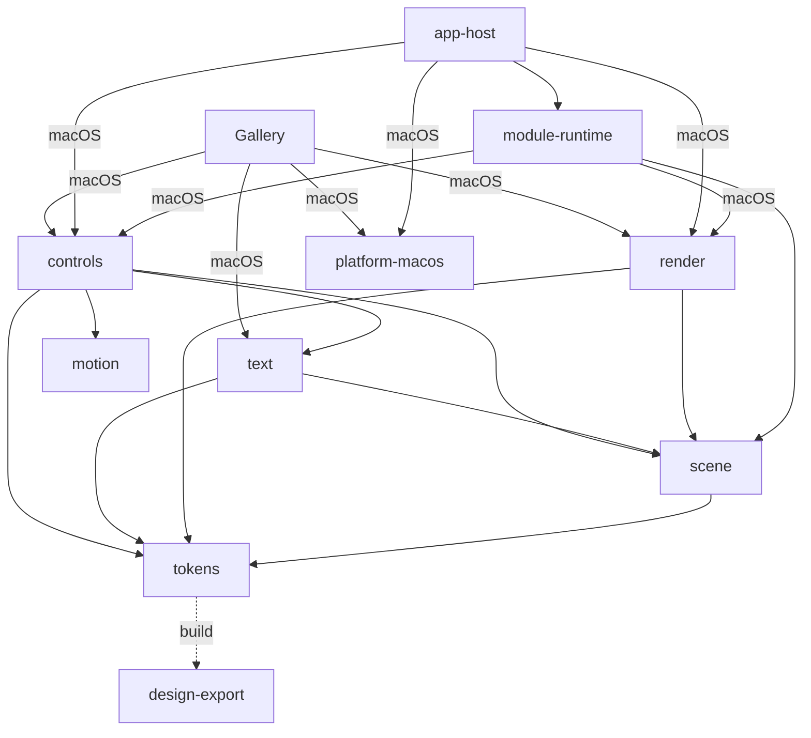

# 架构与平台边界

## 阅读基线与文档职责

2026-10-26，架构事实绑定本地 main **`e39bfaa1785dbedd9672081a8877e27047155885`**。这是代码基线；后续仅文档提交不把未接收源码加入该身份。审计入口 [#137](https://github.com/TekesApps/TekesUI/issues/137)，本轮不做生产代码重构。

[章程](charter.md) 保留定位和长期原则；本文说明实际职责、公共边界、建议演进及其代价；[DESIGN.md](../DESIGN.md) 和 [design/system.json](../design/system.json) 继续拥有设计体系及机器输入；[AppHost 设计](design/app-host-architecture.md) 只拥有宿主契约；[路线图](roadmap.md) 保留功能目标。本文不建立另一套 token、组件规范或动态能力真源。

| 源身份 | 本轮可以证明什么 | 不能推导什么 |
|---|---|---|
| 本地 main `e39bfaa` | 已提交的代码与公共 API；#81、#99/#130、#60、#62 foundation、#115 各批按原收据接收的范围 | 远端已更新、整库/原生/Design System 已完成 |
| Gallery Root `4d09a57282db67519bc89b6a05a2bcdc6ab4828a` 加 WIP | 各 Root 收据所绑定的特定输入；#104/#92 等已交付候选的接收依据 | WIP 等于上述 main；历史 GPU 证明后续源码 |
| #113 私有 `current387-B-derived-button-label-cache88`，manifest `6830c89572f01fc52de590a415205f0da22816492d7651ddfcf60ffe67964214` | 实际 Gallery/Public Button witness、来源绑定及两缓存负例已通过 | 完整首根、全部 52 根或 main 分支通过 |
| 未接收审查笔记/候选 | 作为下一次差量审查输入，保留各自源身份 | 凭笔记数量、测试成功或提交赋予 graph `reviewed` |

当前验证已安全结束。#113 离线证据绑定的首次失败及第二次成功均保留；独立清单仍未证明完整引用全集，14 个 render 首切口的笔记不是可整合片段。详细来源放 SSD `artifacts/architecture-audit-20261026/` 及原 Issue 产物目录；本轮不运行 Cargo/GPU/native、不清理缓存或 worktree，不启动新的实施任务。

## 当前实际职责与依赖

下图只列主要内部依赖，箭头从使用者指向依赖。`build` 边不是运行时依赖；测试边未画入。实际 manifests 及 cfg 优先于示意图。



| 层与依据 | 真实责任和公共边界 | 收益、代价与差距 |
|---|---|---|
| [tokens manifest](../crates/tekes-ui-tokens/Cargo.toml)、[build.rs](../crates/tekes-ui-tokens/build.rs)、[design-export](../crates/tekes-ui-design-export/src/lib.rs) | design-export 是离线/构建期编译和校验工具；tokens 的 build-dependency 使用它，运行时使用生成的 Rust。Palette 显式区分 GalleryBrand 与 ThemeDefinition | 类型化且能拒绝陈旧输入；Python、Rust validator 和 build.rs 分担生成职责，需要一个共享 owner，不能另做颜色引擎 |
| [controls lib](../crates/tekes-ui-controls/src/lib.rs)、[layout](../crates/tekes-ui-controls/src/layout.rs)、[layout_view](../crates/tekes-ui-controls/src/layout_view.rs)、[paint](../crates/tekes-ui-controls/src/paint.rs) | 公开模型/状态、有限布局几何、View 输入/绘制及组合接口；生产依赖 scene/tokens/text/motion，没有 platform-macos、render 或 AppHost | 复用原状态、paint/hit 几何；控件专有布局与状态存在实际耦合。按职责审查有价值，按文件大小拆 crate 不会自动解除耦合 |
| [composition](../crates/tekes-ui-controls/src/composition.rs)、[text_input](../crates/tekes-ui-controls/src/text_input.rs)、[text_surface](../crates/tekes-ui-controls/src/text_surface.rs)、[reading](../crates/tekes-ui-controls/src/reading.rs) | Component/ContentHost 管布局、焦点/capture、事件、语义及生命周期；TextInput 拥有 UTF-16 selection/preedit、undo 和受控更新；TextSurface/reading 管几何与阅读事务 | 避免第二编辑/选择 reducer。组合和文本能力共用事务，提取公共协议有兼容成本；现有这些类型不等于通用 rope/Markdown 文档引擎 |
| [scene](../crates/tekes-ui-scene/Cargo.toml)、[atlas](../crates/tekes-ui-scene/src/atlas.rs) | display list、几何与 glyph atlas，生产依赖 tokens，不依赖 GPU API | 可独立构造/检查绘制数据；它并非连 tokens 都不依赖的完全空白绘图内核，不应为追求“纯分层”另复制颜色/几何类型 |
| [text traits](../crates/tekes-ui-text/src/traits.rs)、[push](../crates/tekes-ui-text/src/push.rs)、[text manifest](../crates/tekes-ui-text/Cargo.toml) | FontFallback/Shaper/Rasterizer；macOS cfg 中有 CoreText 实现；把 Paragraph 字形经 atlas 放入 Scene。render 是 dev-dependency | 协议与平台实现可区分；仍是 mac 优先实现，不证明 DirectWrite/Parley 已支持。无第二使用场景时提取后端 crate 会增加公共类型和生命周期接口 |
| [render manifest](../crates/tekes-ui-render/Cargo.toml)、[renderer](../crates/tekes-ui-render/src/renderer.rs)、[frame](../crates/tekes-ui-render/src/frame.rs) | wgpu 消费 Scene/atlas；生产依赖 scene/tokens，不依赖 text。已有 macOS CAMetalLayer/CoreGraphics surface 接口 | 实际 mac surface 集成明确；“整个 render 无平台类型”不属现状。是否提取 adapter 由第二平台/后端的真实阻塞触发 |
| [platform manifest](../crates/tekes-ui-platform-macos/Cargo.toml)、[view](../crates/tekes-ui-platform-macos/src/view.rs)、[event](../crates/tekes-ui-platform-macos/src/event.rs) | AppKit 窗口/事件/菜单、NSTextInputClient 回调、中性文本快照及系统桥。生产不依赖 controls/render；controls 仅是 native-oracle dev-dependency | 没有生产 `platform → controls` 依赖环。事件/查询与应用状态的接线仍需实际 IME 及窗口验收，不能从 trait 存在推导通过 |
| [component semantics](../crates/tekes-ui-controls/src/composition.rs)、[platform accessibility](../crates/tekes-ui-platform-macos/src/accessibility.rs) | controls 声明真实语义/动作；平台 crate 提供 AccessibilityNode 等快照类型及原生桥；应用负责两种表示的映射 | 当前已有 native adapter，但中性角色/动作到系统节点的完整映射、通知和残留节点是具体风险，需沿 #5 验证。新建 a11y crate 本身不能解决它 |
| [Gallery manifest](../crates/tekes-ui-gallery/Cargo.toml)、[consumer example](../examples/composition-consumer/Cargo.toml) | Gallery 为 publish=false 的消费者/展示与验收应用，正常 macOS 依赖中也包含独立 composition-consumer。examples 为消费者、适配样例或测试夹具 | 能暴露公共 API 缺口；Gallery 与示例耦合需如实说明。基础 controls/text/scene/render 不得反向依赖 Gallery/examples，不能把 Gallery 私有 TextEngine 当公共组件契约 |
| [app-host](../crates/tekes-ui-app-host/Cargo.toml)、[module-runtime](../crates/tekes-ui-module-runtime/Cargo.toml)、[protocol](../crates/tekes-ui-app-protocol/src/lib.rs) | 实验宿主、固定原生模块进程、序列化数据/资源及窗口集成；runtime 的 PanelModule 是子进程内 Rust 接口，macOS 层组合 controls/render | 是同仓可选的集成层，不是基础库必须采用的 App 框架；进程故障边界不等于安全沙箱、任意插件或完整远端交互。#48 原 AC 不因“可选”降低 |
| [scene3d](../crates/tekes-ui-scene3d/Cargo.toml)、[3d app](../crates/tekes-ui-3d/Cargo.toml)、[city](../crates/tekes-ui-city/Cargo.toml) | 可选 3D/glTF 预览及专门夹具/应用；scene3d 实际依赖 render/wgpu，不是另一个纯 Scene 数据层 | 可独立消费与展示；不把城市/产品场景的需求反向变成每个 UI 控件的依赖 |

实际数据流与 Cargo 依赖方向不同：平台事件由应用 handler 转为控件/ContentHost 操作；状态 owner 提交布局/paint，文本适配器用 shaper/rasterizer/atlas 向 Scene 写入字形；renderer 消费 Scene/atlas。平台提供窗口/layer，应用负责将它与 renderer 连接。这里描述职责，不重签任何原生验收。

## Design System：统一体系与尚未交付的消费闭环

Gold7、Theme Schema、具体 Theme、Surface 规则、组件契约属于同一 Design System，但不是一种数据或一个通过条件。`design/system.json#/theme_system/root_concept` 已明确 Design System 同时拥有 Theme Schema、定义、生成校验和组件契约；本轮不缩减这个范围。

作者 JSON / BrandConfig / policy → 离线合并 token 投影与 Theme instances → 正常 Cargo freshness/Theme verifier → typed Rust、品牌/Theme 表 → Palette / Surface resolver → 真实组件。依据 [生成入口](../design/README.md)、[build.rs](../crates/tekes-ui-tokens/build.rs)、[Theme validator](../crates/tekes-ui-design-export/src/theme_system.rs)、[Palette](../crates/tekes-ui-tokens/src/palette.rs)、[Surface resolver](../crates/tekes-ui-tokens/src/surface_palette.rs)。token 颜色消费不在运行时调用 Python 或编译 Theme JSON；这不表示 Gallery 不解析自己的 registry 等数据。

main 的 `delivery_status` 明确是 `foundation-api-only`。当前 controls 尚无 `resolve_surface*` 调用，仍有直接 proposal/Palette 绘制；Root 已验收的组件迁移不得改签为 main 已闭合。差距首先是 **#136 接收已有产出**，而非重新开发 #62/#104/#92 已有成果。

已有原则继续执行：声明 Surface 解剖/语义用途的组件绘制必须消费完整共享结果，不能维护组件私有状态色表或由 RGB 反推身份。typed metric/layout/motion API 仍是生成投影的一部分；文本颜色也不自动豁免其实际 Surface 契约。组件行为、状态、输入和生命周期属于组件契约，不能被主题 JSON 或静态颜色检查替代。Gold7 验设计、接线和实际体验；#113 的依赖闭包也不能代替 Gold7/原生验收。

## 架构决定、代价与确认边界

以下“继续”沿用已有原则；“建议”经过 advisor 审查，尚未替用户批准重大方向。原 Issue AC **本轮无实质变更**。

| 决定 | 建议与收益 | 代价、触发条件与唯一入口 |
|---|---|---|
| 继续：控件状态、布局/paint/hit、编辑与语义 owner 不复制 | 先按 controls 内模型/交互、布局、绘制、组合和文本编辑划清责任；公共 Consumer 验证边界 | 大模块仍有耦合，不能因不拆 crate 而忽略事务/兼容风险；具体功能继续原票，不建通用框架 |
| **A1 待确认：能力边界优先于固定 crate 名单** | 不为匹配旧图立即建 doc/edit/layout/a11y crate；减少类型迁移、版本与依赖成本 | 独立消费者、真实依赖环/平台阻塞、独立事务或可测构建/测试需求可触发提取，不机械要求两个消费者。方向确认入口 #137；具体设计继续 #131/#132/#135 |
| **A2 待确认：AccessKit 改为比较候选** | 优先核验现有 native adapter 的角色/动作/通知映射，避免以技术替换重做已验功能 | 这改变旧章程指定路线，须用户确认；确认前保留承诺，不启动重写、不宣称 #5 通过。实施验收唯一入口 #5 |
| **A3 待确认：文档/完整编辑器为可选能力层** | 通用 UI 的基础输入/阅读继续可用；rope、虚拟文档、Markdown 映射按真实需要设计 | 不取消 F3–F5；需要源文档、持久化、事务和投影映射的新协议仍须独立设计。#131（文档/规模）、#132（Markdown）保留后置原 AC |
| 继续并如实标注：mac 优先的 text/render adapter | 保留现有位置，不为无消费者的跨平台抽象增加公共 API | #135 的第二平台/后端阻塞实际出现时再决定提取；不把重构当控件验收前置 |
| 继续：宿主是可选集成层 | foundation 不反向依赖 AppHost；消费方可选择普通 Content 或 ProcessContainer | 不能降低 #48 的固定公开 SHA、独立 consumer、真实 IPC、IME/AX/生命周期验收；不变成全库必备沙箱/插件框架 |

## 差距、原计划去向与后续执行队列

下表是原 AC 的投递与调度索引，不替换其完整条款。root 为唯一主工作树整合者；Theme/schema/生成器/共享规则、#113 共享接口各保持单一负责人；组件族实施者仅能写各自冻结的私有候选。实施 owner 未重新分配；本轮没有新生产任务。

| 差距 / 原计划 | 去向与理由 | 唯一入口、负责人、依赖与允许范围 | 下一交付 / 原验收索引 |
|---|---|---|---|
| 章程图与 e39 职责不符 | 调整事实说明；重大方向待确认 | #137，root；仅本轮明确文档 hunks | A1–A3 审查/用户决定；不关闭其他票、不改变原 AC |
| Root 产出尚未进入 main | 继续接收，优先于重新开发 | #136，root；冻结原票 source/hunks 与不可拆依赖，禁止整目录复制 | 优先只读冻结 #104 共享 Theme 链及 #92 ChartContent 的最小依赖批；#115 已在 main。完整可解释批才实施/验证/提交，不预先声称两票单独可拆 |
| 组件语义色及整体系迁移 | 继续既定契约，基础 API 不替代消费 | #1（父 #55），Theme owner；仅适用组件/共享用途，依赖实际已接收接口 | 分批组件消费、原视觉/输入标准；不得追加整个 DS 为单票前提 |
| Button 首根与 52 根闭包 | 继续原范围，本轮冻结在途交接 | #113，原共享 owner；实际88 evidence binder、独立引用清单、完整 owned 源审，不改规则开脱未知边 | 完整条件公共模板＋具名 action20 原闭包/负例；保留其他 callsite 与 52 根义务；完整方法冻结前 #121–#125 不启动 |
| 机器能力报告 | 继续，但只投影已接收范围 | #114，投影 owner 之后指定；依赖 #113 被接收的闭包，父 #8 | partial 不能 complete；旧刷新及程序证据保原身份 |
| 真实语义树/平台映射 | 继续，crate 拆分不能替代功能 | #5，原语义/平台 owner；只改对应映射/通知/真实行为，依赖已交付组件 | ID、role/name/value/action、隐藏/模态、焦点恢复和真实 VoiceOver；A2 未确认不换技术路线 |
| 文档、虚拟化、编辑器、系统服务、终端、其他平台 | #131–#135 继续后置，不取消原目标；本轮不启动 | 各原票是唯一设计入口，协调 root、实施 owner 未分配 | #131 稳定 key/回收/驱逐锚点；#132 源文档/编辑映射；#133 系统服务；#134 许可/一致性；#135 平台矩阵；按原 AC 设计后再去重拆实施 |
| 现有输入/数值明确缺陷 | 继续独立跟踪，不靠架构重构掩盖 | #128 / #129 各自唯一入口，原 owner/依赖保持；本轮未派新实施 | 原连续组字/字素及禁用同步值反例与回归，不能以改架构关闭 |
| ProcessContainer 与现有有限远端/图像候选 | 保留完整交互及公开交付要求 | #48（完整交互）；#127（有限边界）；#117（图像原交付）分别唯一入口 | 不把有限 Class B 改称完整 Toolbar 组合通过；公开不可变版本未授权则仍留原票，不重复本地功能开发 |
| 整页/原生/Gold7体验 | 继续原验收，不作为所有子票统一门槛 | #12；图标风格独立 #57 | 固定 Gallery、原 IME/VO/性能等实际范围；不因架构文档或闭包报告更新成熟度 |

本轮审计及随后原范围收口的推荐顺序（A1–A3 不成为全部既有工作的前提）：

1. **本轮批次**：完成 #137 的事实/文档/Issue 对齐、本地文档提交和待确认决定；不启动新实施或缓存切换。
2. **只读接收准备可并行**：root 审 #113 已交付 binder/清单/源审笔记；另一条准备 #136 Theme/Chart 的源差量、API 依赖、允许 hunks、原证据及真正失效检查。审查不等于接收，14 个 pending 不能批量置 reviewed。
3. **本轮审计完成后，沿既有授权收口**：优先完整既有 main 接收批，在最终落点集中必要验证；无法闭合的依赖明确退回原票。#113 只补首根原缺口，不再扩通用分析器。等待构建锁时做审查/准备，不增加重复验证。只有涉及 A1–A3 方向改变或原 AC 实质变化的代码实施须先获用户确认，不能把这些决定追加为 #136/#113 原范围的统一前提。
4. **首根方法/共享接口冻结后**：#121–#125 按独立组件族分批并行，数量以 root 可及时接收为限；共享 schema/生成器/规则不分叉。#114 随已接收闭包准确投影。
5. #131–#135、无关新功能及重大重构仍后置；公开交付沿原票等待具体授权，不借架构审计 push/发布。

## F0 历史接口与验证记录（不是当前 API 清单）

以下保留 F0 当时的接口、事件、帧节奏和实测记录；其中“现在”“将来”“F5 再做”等措辞只指该历史阶段。当前已存在 NSTextInputClient、display-link 等实现，不能由下文旧预留推断它们不存在，也不能由旧实测宣布 e39 全部通过。当前 API 以对应提交的源码为准，现状及目标边界以上述章节为准。

F0 当时的边界是：平台负责窗口、事件泵、菜单和外观，以 CAMetalLayer 指针与 renderer 衔接。当前平台 crate 仍不生产依赖 render；但 renderer 自身已有 macOS surface 代码，不能扩写成全引擎都不接触 objc2。

## 接口一览

```rust
let app = App::new(AppConfig::default());            // 只能在主线程
app.run(window_config, menu_bar, handler);           // 阻塞，直到应用结束；返回后处理器已 Drop

pub trait WindowHandler: 'static {
    fn handle(&mut self, event: Event, window: &mut Window);
}
```

- `AppConfig { name, quit_after_last_window_closed }`：应用名用于标准菜单标题；默认最后一个窗口关闭后 `run()` 返回。
- `WindowConfig { title, size, min_size, placement, frame_autosave_name }`：`size` 是内容区尺寸（pt）。`frame_autosave_name` 默认 `None`（关闭），Gallery 需要固定、可复现的窗口尺寸，不能被上次的拖动改变；设了名字时，有保存的位置就恢复，并跳过 `placement`。
- `MenuBar { menus: Vec<Menu> }`：见“菜单”一节。
- `Window`（只在 `handle` 里临时给出，不是 `Send`）：

| 方法 | 作用 |
|---|---|
| `request_redraw()` | 请求重绘，合并 |
| `set_title(&str)` | 设标题 |
| `size() -> Size` | 视图尺寸，pt |
| `scale() -> f64` | `backingScaleFactor` |
| `drawable_size() -> (u32, u32)` | CAMetalLayer 当前 drawableSize，像素 |
| `metal_layer() -> NonNull<c_void>` | CAMetalLayer 指针，给渲染层建 wgpu surface |
| `close()` | 关窗，不经过 `CloseRequested` |
| `set_content_size(Size)` | 改内容区尺寸 |
| `set_command_checked(CommandId, bool) -> bool` | 菜单勾选；命令不存在返回 false |
| `is_command_checked(CommandId)` | 读勾选状态 |
| `placement_report()` / `screen_info()` | 摆放结果与当前屏幕，日志用 |
| `native_window_number()` / `redraw_count()` | 诊断用 |

## 事件

```rust
pub enum Event {            // #[non_exhaustive]
    Created,
    Resized { size: Size, scale: f64, drawable_size: (u32, u32) },
    Redraw,
    Mouse(MouseEvent),      // Down/Up{button, click_count}、Moved、Dragged{button}、Entered、Exited
    Scroll(ScrollEvent),
    Key(KeyEvent),          // Down/Up，key_code、characters、characters_ignoring_modifiers、is_repeat
    ModifiersChanged(Modifiers),
    Focus(bool),
    Command(CommandId),
    SystemAppearanceChanged { dark: bool, increase_contrast: bool },
    CloseRequested,
}
```

- **坐标**：视图坐标，单位 pt，原点在左上角，y 向下。视图 `isFlipped = true`，由 AppKit 在 `convertPoint` 里翻转，平台层不手写 `height - y`；自测里合成的点击在窗口坐标 (100, contentHeight-50) 处，收到的位置是 (100, 50)，验证了这一点。
- **滚动**：`delta` 取自 `scrollingDeltaX/Y`，符号不改，已包含系统“自然滚动”设置；`delta.y > 0` 表示内容向 y 增大的方向移动。`precise` 为 true（触控板）时单位是点，为 false（普通滚轮）时单位是行，行高由引擎定。`phase` 与 `momentum_phase` 逐值转录 `NSEventPhase`，不解释、不模拟惯性（章程原则 4）：手指离开后系统继续发 `phase = None`、`momentum_phase = Began/Changed/Ended` 的事件。
- **键盘**：`key_code` 与布局无关；`characters` 在功能键、方向键上是 AppKit 的私有区字符。现在不调用 `interpretKeyEvents:`，输入法与死键不工作，F5 再做。未处理的按键不调 super，没有系统提示音。
- **鼠标进出与移动**：靠 `NSTrackingArea`（`MouseEnteredAndExited | MouseMoved | ActiveInActiveApp | InVisibleRect`），不要求窗口是 key window。窗口未激活时的第一次点击也送达视图（`acceptsFirstMouse`）。
- **Focus**：跟随窗口的 key 状态。
- **CloseRequested**：红色按钮和 ⌘W 都会来，平台层不替引擎决定，拒绝关闭并投递事件，引擎调用 `Window::close()` 才真关。不响应它的引擎窗口关不掉。⌘Q 目前直接结束应用，不经过 `CloseRequested`，将来需要“退出前确认”时再加 `QuitRequested`。
- **输入法预留**：`Event` 里没有 preedit 变体，也没有空壳实现。F5 增加时按章程第 4 节：`Preedit` 带组字串、分节区间（clause segments，含起止偏移和是否当前转换节）与组字内光标位置；`Commit` 带文本与 `replacementRange`；`firstRect`、`selectedRange`、`attributedSubstring` 做成 `WindowHandler` 上的同步查询方法，不走事件。位置见 `event.rs` 里 `Event` 的文档注释。

### 启动与结束的事件顺序

`applicationDidFinishLaunching` 里，在窗口显示之前同步投递：

1. `Created`：视图、CAMetalLayer 已创建，`metal_layer()` 可用；
2. `SystemAppearanceChanged`：初始值，无条件投递；
3. `Resized`：初始尺寸、缩放、drawable 尺寸；
4. `Redraw`：同步，所以窗口第一次出现时第一帧已经画好；

之后 `makeKeyAndOrderFront` 引起 `Focus(true)`。`run()` 返回之前处理器被 Drop；`terminate:`（⌘Q、最后一个窗口关闭）不会让 AppKit 调 `exit()`，而是停掉事件循环（`applicationShouldTerminate` 返回取消，同时 `stop:` 并补发一个空事件唤醒循环），所以 `run()` 之后调用方还能收尾。

## 帧节奏：按需，空闲时什么都不跑

**空闲状态没有 CVDisplayLink、CADisplayLink 或任何定时器。** 主线程停在 `mach_msg`，只有三类来源会让平台层投递 `Redraw`：

1. 引擎调用 `request_redraw()`；
2. 尺寸或缩放变化（同步，见下一节）；
3. 启动时的第一帧。

`request_redraw()` 的实现：用一个 `redraw_pending` 标志合并，第一次置位时用 `performSelectorOnMainThread:withObject:waitUntilDone:modes:`（common modes）往主 runloop 排一个一次性回调 `tekesPerformRedraw`；回调里清标志并投递 `Event::Redraw`。同一轮 runloop 里多次调用只产生一次 `Redraw`（自测：连续两次 `request_redraw` 只多一次 Redraw）。处理 `Redraw` 时再调用 `request_redraw()` 表示“下一帧还要画”。回调不依赖 AppKit 的显示周期，也不是定时器：没有排队的回调时 runloop 不会被唤醒。

### 为什么不用 `setNeedsDisplay` 加 `updateLayer`

最初的设计是 `setNeedsDisplay(true)`，由 AppKit 调 `updateLayer`。实测（macOS 26，Darwin 25.6）行不通：背衬层是 CAMetalLayer 时，`setNeedsDisplay:` 会被转成层的 `needsDisplay`，视图自己的标志立刻变回 false，但 CAMetalLayer 不执行 display，所以 `updateLayer` 一次也不会被调用，连同步的 `[view display]` 也不会。`wantsUpdateLayer = true` 和 `updateLayer` 的实现仍然保留（AppKit 万一因别的原因调用，照样投递 `Redraw`），但不能依赖它。

### 将来的 CADisplayLink

需要持续动画（滚动惯性、光标闪烁以外的动画、120Hz 验收）时，在 `Shared`（`shared.rs`）里加一个只在“有动画”时存在的 `CADisplayLink`（macOS 14 起 `NSView.displayLink(target:selector:)`，自动跟随窗口所在屏幕的刷新率）。它的回调直接调用 `dispatch(Event::Redraw)`；动画结束时 `invalidate`，回到按需状态。引擎侧的形式可以是 `Window::set_animating(bool)`。现在不实现。

另外，`Window` 不是 `Send`，`request_redraw` 只能在主线程调用。后台任务唤醒 UI 需要一个跨线程的代理（向主队列投递，再 `request_redraw`），也留到有需求时加。

## 实时缩放

- **尺寸变化同步投递**：`setFrameSize:`（缩放过程中 AppKit 每一步都会调）里，先调 super，再把层的 `drawableSize` 设成 `size * scale`（四舍五入，每维至少 1），然后同步投递 `Resized` 与 `Redraw`，不等下一轮 runloop。这样缩放过程中窗口与内容同一步更新，不会出现窗口已变而内容还是旧尺寸。
- **缩放因子变化**（`viewDidChangeBackingProperties`：换屏幕、改分辨率）与 `viewDidMoveToWindow` 走同一个 `sync_geometry`；层的 `contentsScale` 同步到 `window.backingScaleFactor`。几何信息（尺寸、缩放、drawable）与上次投递的相同则不重复投递。
- **drawableSize 归渲染器管**：wgpu 配置 surface 时设置它，平台层不碰（在渲染器接管之前，CAMetalLayer 自己按 `bounds * contentsScale` 算）。`Resized.drawable_size` 是平台层算出的像素尺寸（`size * scale` 取整），渲染层用它调用 `Renderer::resize`。`contentsScale` 归平台层管，随 `backingScaleFactor` 同步。
- **色彩空间**：层的 `colorspace` 设为 sRGB，渲染层在 gamma 空间混合，与 AppKit 一致，不让系统再做一次色域转换。层 `opaque = true`，视图 `isOpaque = true`。
- **`layerContentsRedrawPolicy = OnSetNeedsDisplay`**：不让 AppKit 在缩放时自己重绘层内容。默认的 `DuringViewResize` 会在我们的同步重绘之后再触发一次，同一次缩放画两帧，还会与渲染层写入的 drawable 冲突。注意 `setWantsLayer(true)` 会把策略重置成 `Never`，必须在它之后设置（实测）。
- **`layerContentsPlacement = TopLeft`**：新 drawable 还没来时，旧内容按原尺寸钉在左上角，不拉伸，也不居中漂移；窗口变大时露出的是层的背景色。不能直接设层的 `contentsGravity`，AppKit 管着背衬层，会按视图的 `layerContentsPlacement` 改写它（实测：直接设的值被改回 `resize`）；视图设 `TopLeft` 后，AppKit 把层的 gravity 设成 `bottomLeft`（因为层是 geometry-flipped，两者是同一个视觉位置）。验证：自测给层塞一张 200x200 像素（2x 下 100pt）上红下蓝的图，窗口放大后截图，图仍在左上角、大小不变、上红下蓝，没有拉伸。
- **`presentsWithTransaction`**：平时关闭；`viewWillStartLiveResize` 时自动打开，`viewDidEndLiveResize` 时关闭，不是公开 API。wgpu 在每次取 drawable 时读取它，为 true 时改用 `commit + waitUntilScheduled + present`，实时缩放时内容与窗口边框在同一个 Core Animation 事务里更新。平台层的同步 `Resized` + `Redraw` 就在 `setFrameSize:` 里、主线程上完成，满足这个路径的要求。程序化缩放（`setContentSize`）不算实时缩放，不开。

## 重入

AppKit 常常在我们调用它的过程中同步回调回来：引擎在 `handle` 里调 `set_content_size` 时，AppKit 立刻调 `setFrameSize:`；调 `close` 时立刻调 `windowWillClose:`。回调里又要投递事件，如果直接再调一次 `handle`，同一个 `&mut handler` 就有了两个可变引用，对 `RefCell` 则是二次借用而 panic。做法（见 `shared.rs`）：

1. 所有 `RefCell` 的借用都不跨越外部调用（AppKit 调用、`handle`），取出、放回都在一条语句里完成；
2. 处理器“取走再放回”：分发期间 `handler` 槽是 `None`；
3. `dispatching` 标志表示有一个分发循环在运行。重入的 `dispatch` 只把事件放进队列就返回，由外层循环在当前 `handle` 返回后按顺序投递，任何时刻最多一个 `handle` 在运行，事件顺序不变；
4. 队列里相邻重复的 `Redraw` 合并；
5. `Window` 只是一组 `Retained` 引用和一个 `Rc<Shared>`，每次分发时临时构造，不持有任何借用，`handle` 里调它的任何方法都不会二次借用。

验证：示例的 `handle` 入口有 `assert!(!busy)`，菜单项 “Grow Window (reentrancy)” 在 `handle` 里调用 `set_content_size`，日志显示 `set_content_size` 先返回，随后才依次收到排队的 `Resized` 与 `Redraw`，没有嵌套；示例在 `Redraw` 里每次 `set_title` 也没有问题。处理器 panic 会穿过 AppKit 的 C 栈帧，objc2 会直接终止进程，不做恢复。

## 菜单

引擎提供纯数据的 `MenuBar`：菜单 → 项，项有标题、快捷键（`KeyEquivalent { key, modifiers }`）、`CommandId(u32)`、初始勾选状态，以及分隔线。`MenuBar::validate()` 检查标题非空、命令编号唯一，`run()` 对不合法的描述 panic。

平台层自动生成并安装：

- 应用菜单：About、Hide、Hide Others（⌥⌘H）、Show All、Quit（⌘Q）；
- 引擎的菜单（按给定顺序）；
- Window 菜单：Minimize（⌘M）、Zoom、Close（⌘W）、Enter Full Screen（⌃⌘F），并设为 `windowsMenu`，窗口列表由 AppKit 追加。

标准项使用 AppKit 标准 selector，target 为 nil，沿响应链处理（`terminate:`、`performClose:`、`toggleFullScreen:` 等），不需要引擎参与。引擎的命令项统一指向委托的 `menuItemSelected:`，`tag` 携带 `CommandId`，选中时投递 `Event::Command`。勾选状态用 `Window::set_command_checked` 修改（遍历主菜单按 tag 查找），Gallery 用它做 light/dark/increase contrast 的单选勾选：选中一个时由引擎自己取消其他项。暂无启用/禁用状态。

## 系统外观

`SystemAppearanceChanged { dark, increase_contrast }` 在启动时无条件投递一次，之后只在值变化时投递：

- 深浅色取视图的 `effectiveAppearance`（`bestMatchFromAppearancesWithNames([Aqua, DarkAqua])`），变化时 AppKit 调 `viewDidChangeEffectiveAppearance`，所以窗口或应用单独设置的外观覆盖也会反映；
- 增强对比度取 `NSWorkspace.accessibilityDisplayShouldIncreaseContrast`，变化由 `NSWorkspaceAccessibilityDisplayOptionsDidChangeNotification` 通知（委托作 observer）。

## 窗口摆放

开发规则（用户规则，适用于示例、测试窗口和 Gallery）：

1. 有外接显示器，放外接显示器，除非检查需要 120Hz（ProMotion）；需要 120Hz 时放内建显示器；
2. 没有外接显示器、且检查与窗口尺寸无关时，放在内建显示器的右半边；
3. 缩放、窗口尺寸类检查免除右半边规则（居中）。

实现在 `placement.rs`（纯逻辑，可单测）与 `screens.rs`（枚举 `NSScreen.screens`）：

```rust
pub enum WindowPlacement {
    Centered,                                          // AppKit center()，默认
    Auto { need_120hz: bool, size_check: bool },       // 按上面的规则
    RightHalf(ScreenChoice),                           // 指定屏幕的右半边
    Screen(ScreenChoice),                              // 指定屏幕居中
}
pub enum ScreenChoice { Builtin, External }            // 缺外接屏时 External 退回 Builtin
```

- 内建屏判定：`CGDisplayIsBuiltin`（取自屏幕 `deviceDescription["NSScreenNumber"]`）；`ScreenInfo` 带名称、是否内建、缩放、`maximumFramesPerSecond`、frame 与可用区域。
- “右半边”指内建屏可用区域（扣掉菜单栏与 Dock）的右半边，窗口在其中居中；窗口比半边宽时靠右对齐，右边缘不出屏；窗口比屏幕高时保证标题栏可见。
- 理解说明：规则 1 里“需要 120Hz 放内建屏”之后是否再取右半边，原文没有说；这里的做法是：落在内建屏就套用规则 2/3（右半边，尺寸类检查居中），因为同样要避免盖住左边的工作窗口。
- 环境变量 `TEKESUI_WINDOW_PLACEMENT` 覆盖配置：`auto`（保留配置里 `Auto` 的两个标志，配置不是 `Auto` 时都为 false）、`external`、`builtin`、`builtin-right-half`、`centered`。不认识的值打印警告后忽略。
- 库的默认值是 `Centered`，不替产品应用做摆放；示例和 Gallery 在配置里写 `Auto`。
- 日志：`Window::placement_report()` 给出选中的屏幕（名称、是否内建、缩放、最大帧率）、布局、原因与全部屏幕；`Window::screen_info()` 给出窗口当前所在屏幕。示例在 `Created` 时打印。

## 窗口遮挡

`windowDidChangeOcclusionState:`：窗口变为可见（最小化后恢复、被完全盖住后露出）时调用 `request_redraw()`。不可见期间渲染层取 drawable 会得到 Occluded，跳过帧并返回 Ok，不补这一帧就会停在旧画面。

## 与渲染层集成要点

- 渲染层从 `Window::metal_layer()` 得到 CAMetalLayer 指针，用 `SurfaceTargetUnsafe::CoreAnimationLayer` 建 surface。指针在窗口存活期间有效，渲染层不要 release 它。
- `Created` 时层已存在、`drawableSize` 已设好；`Resized` 在 `Redraw` 之前，每次 `Resized` 后必然紧跟一次同步 `Redraw`。渲染层应在 `Resized` 里重新 `configure`，在 `Redraw` 里 acquire、绘制、present。
- 平台层设置 `contentsScale`、视图的 `layerContentsPlacement`（层 gravity 由 AppKit 据此生成）、`opaque`；渲染层（wgpu 的 configure）设置 `drawableSize`、`pixelFormat`、`framebufferOnly`、`device`、`maximumDrawableCount`、`displaySyncEnabled`，并在每次 configure 之后重新把 `colorspace` 设成 sRGB（wgpu 会把它重置为 nil；平台层建层时设的 sRGB 因此会被覆盖，以渲染层为准）。
- `presentsWithTransaction` 由平台层在实时缩放期间自动开关，渲染层不用管，见“实时缩放”。
- 窗口重新可见时平台层会 `request_redraw()`，见“窗口遮挡”。
- 引擎的处理器 `Redraw` 里发现还要画下一帧时，调用 `request_redraw()`。

## 验证记录（F0）

环境：MacBook 内建 Liquid Retina XDR（1512x982 pt，2x，120Hz）加一块外接 4K 显示器 U2790B（1920x1080 pt，2x，系统报 30Hz）。按摆放规则，示例默认落在外接屏。

自测：`TEKES_SELFTEST=1 cargo run -p tekes-ui-platform-macos --example window`（`hold` 取值则做完保留窗口）。示例从后台线程按时间表向主队列投递步骤，步骤里直接操作 AppKit（合成鼠标、键盘、滚轮 NSEvent，菜单 `sendAction`，`setContentSize`，窗口 `setAppearance`，`performClose`），最后正常退出，退出码 0。该自测覆盖：

- 点击位置翻转、双击 `click_count = 2`、拖动、键盘字符与 key_code、⌘1 触发 `Command`；
- 滚轮 `phase`/`momentum_phase` 逐值转录（Began/Changed/Ended，momentum Began/Changed/Ended）；
- 菜单命令、连续两次 `request_redraw` 合并为一次；
- 缩放：22 步 `set_content_size`，每步一个 `Resized` 紧跟一个 `Redraw`，drawable 尺寸正确；
- 窗口外观切换产生 `SystemAppearanceChanged`；
- `handle` 内改窗口尺寸的重入；
- 红色按钮路径 `performClose` → `CloseRequested` → `close()` → `run()` 返回；
- 层的滞留图像不拉伸（截图）。

空闲（`scripts/measure-idle-cpu.sh <pid> [秒数]`，基于 `top -l N -s 1 -pid`，丢弃首个样本）：启动稳定后 30 个样本，CPU 每秒均为 0.0%，中位数 0.0%，最大 0.0%，空闲唤醒合计 0；同一时段示例日志里 Redraw 计数保持 27 不变。`sample <pid> 5`：主线程的全部样本都在 `mach_msg`（`NSApplication run` 里），另一个线程是 `NSEventThread`，同样停在 `mach_msg`。

单元测试：修饰键转换（含对照 objc2-app-kit 常量）、鼠标键号、滚动阶段、drawable 尺寸取整与下限、菜单描述校验、摆放规则与坐标计算。

未验证：

- **1x 屏幕**：没有 1x 显示器，Retina 以外的缩放因子路径（`contentsScale = 1`、拖动窗口跨 1x/2x 屏幕触发 `viewDidChangeBackingProperties`）未测。两块屏幕都是 2x。
- **增强对比度的变化通知**：改它是修改系统设置，没有测；启动时的读取路径已验证（`false`），变化路径只由代码保证。深浅色变化用窗口级外观覆盖验证了视图回调，没有切换系统外观。
- **真实触控板滚动与真实鼠标输入**：滚轮用合成事件验证；真实鼠标的移动、进出事件在示例运行时有过（窗口收到过 Entered/Exited），没有系统化验证。
- **实时缩放的视觉效果**（用鼠标拖边框时有没有撕裂或抖动）：用 `setContentSize` 序列验证了事件序，没有对着真实 wgpu 呈现看；`viewWillStartLiveResize` 没有接入。
- **多窗口**：当前一个 `run()` 一个窗口。
- **⌘Q 之前的确认**、菜单项启用/禁用、剪贴板、输入法：未做。
- **手动拖动、真实键盘快捷键**：自测通过 `NSApp.sendEvent` 合成，与真实输入走同一套 AppKit 响应链，但没有用 USB/辅助功能真实输入验证。
- 提示：自测的步骤间隔由后台线程的 sleep 决定，窗口被遮挡或后台时 App Nap 可能把它拖慢，日志里的时间戳会偏大，步骤顺序不变。
